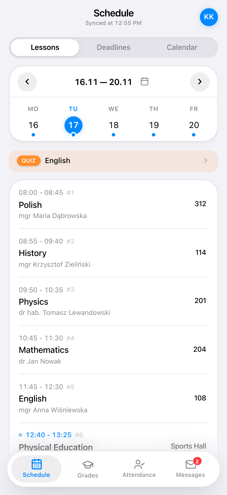
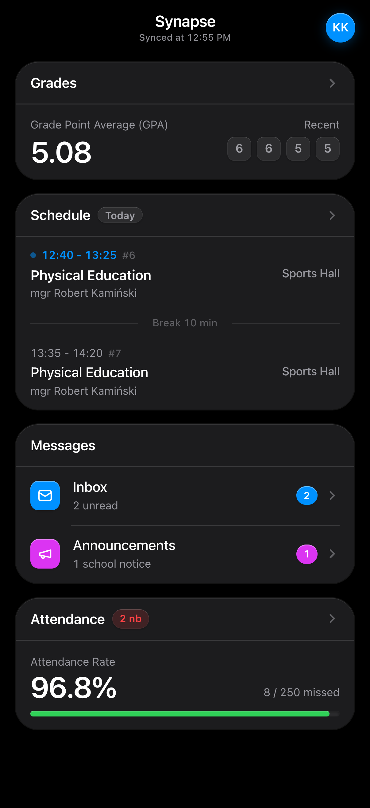
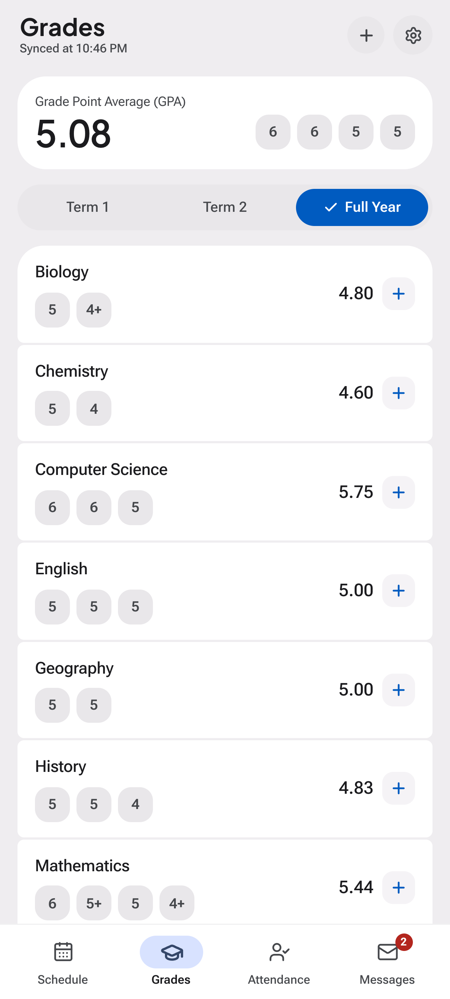
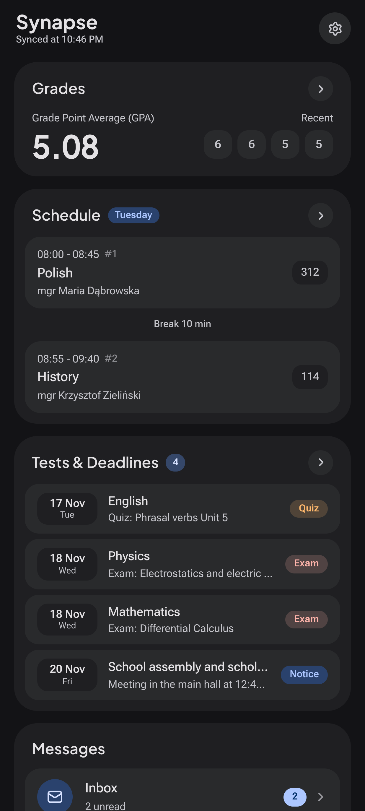
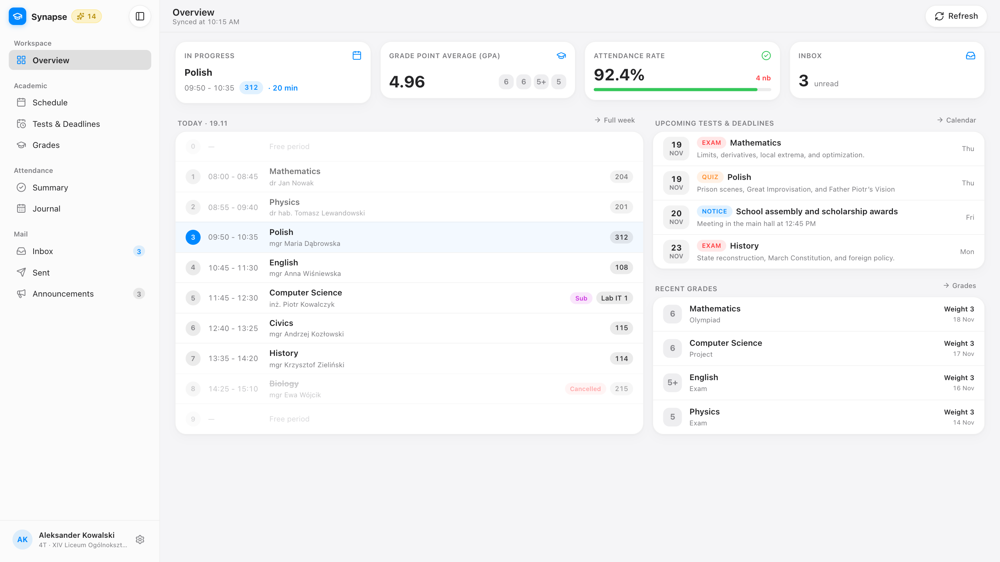

# Synapse — "E-Dziennik" `[WIP · Alpha]`

**[🇬🇧 English](README.md)** · **[🇵🇱 Polski](README.pl.md)**

**A fast, private, ad-free "E-Dziennik" client for Poland's Librus Synergia school portal** — built to replace cluttered web portals and paywalled mobile apps with a focused daily dashboard across phones and desktops.

[](https://vercel.com/new/clone?repository-url=https%3A%2F%2Fgithub.com%2Fcra1zer2%2FSynapse)

> **🚀 Live Preview & Instant Demo:** Open **[synapse-ten-smoky.vercel.app](https://synapse-ten-smoky.vercel.app)** and sign in with **`demo` / `demo`** (student) or **`demor` / `demo`** (parent) to explore the full app right away — no Librus account needed.
>
> **⚠️ WIP / Alpha Status:** Synapse is currently in **Alpha**. The **Desktop layout** and the **Bottom Navigation Bar** variation are actively in development (`WIP`), so **opening the app on a phone (with the default Widgets view) is currently recommended** for the best experience.

> Subtly inspired by clean modern mobile design principles, Synapse works as an adaptive web and PWA hybrid: fluid touch cards on smartphones and an expanded multi-column workspace on desktop monitors — with zero ads, zero tracking, and no central servers.

---

## Visual Overview

<p align="center">
  <a href="docs/screenshots/en/iphone-light-tabs.png" title="iPhone Pro · iOS Light + Bottom Bar">
    
  </a>
  <a href="docs/screenshots/en/iphone-dark-widgets.png" title="iPhone Pro · iOS Dark + Widgets">
    
  </a>
  <a href="docs/screenshots/en/pixel-light-tabs.png" title="Pixel XL · Material 3 Expressive Light + Bottom Bar">
    
  </a>
  <a href="docs/screenshots/en/pixel-dark-widgets.png" title="Pixel XL · Material 3 Expressive Dark + Widgets">
    
  </a>
  <br /><sub><b>Mobile Variations:</b> iPhone Pro (iOS Light · Tab Bar) · iPhone Pro (iOS Dark · Widgets) · Pixel XL (M3 Light · Tab Bar) · Pixel XL (M3 Dark · Widgets)</sub>
</p>

<p align="center">
  <a href="docs/screenshots/en/desktop-workspace.png" title="Adaptive Desktop Workspace (Light Mode)">
    
  </a>
  <br /><sub><b>Responsive Desktop Workspace</b> — expands automatically to a two-column layout showing the full daily timetable beside grades, tests, messages, and attendance</sub>
</p>

---

## Why Synapse

After the shutdown of popular open-source Android gradebook clients, thousands of Polish students and parents were forced back onto official portals packed with ads, slow multi-step navigation, and paywalls around core features like push views and convenient summaries.

**Synapse** solves that everyday pain cleanly:
- **Actually fast in daily use** — opens straight into cached local data and silently syncs updates in the background instead of reloading heavy multi-page web tables.
- **Privately self-hosted for free** — no shared third-party backend ever holds your school credentials. You deploy your own private copy on Vercel in a minute (or run it locally) and add it straight to your phone's home screen.
- **Built for both students and parents** — switch effortlessly between student and parent accounts, inspect subject deviations, or send e-excuses in seconds.

---

## Key Capabilities

- **Today at a Glance**: Live lesson status, break timer, room changes, recent grades, and unread messages on one customizable home view.
- **Timetable, Exams & Calendar Export**: Automatic merging of double periods, highlighted substitutions/cancellations, upcoming exams/homework timeline, and one-tap `.ics` export to external calendars.
- **Weighted Grades & Interactive What-If Simulator**: Instant semester and full-year GPA calculation (`+0.5 / -0.25`), restrained typography that flags only alert marks (`nb`, `0`, `1`) in red, and a top-bar `+` simulation mode with pulsing subject selection and a spacious modal sheet for testing hypothetical grades and weights.
- **Attendance & Parent e-Excuses**: Daily presence indicators separated from the deviation journal (`nb`, `usp`, `sp`, `sL`, `zw`), threshold alerts (`50%` / `75%`), and direct e-excuse submissions with live approval tracking.
- **Messages & School Notices**: Distraction-free inbox, sent folder, staff directory lookup, attachment downloads, and announcements.
- **Extensible Localization & Live Translation**: Seamless interface switching via `LANGUAGE_REGISTRY` (`PL / EN` ready for additional languages) paired with automatic real-time Google Translate rendering of dynamic Librus content (subjects, lesson topics, exam & homework details, grade categories/comments, absence types, messages, and announcements) while keeping names, classrooms, dates, and attachments untouched.

### Customization & Controls

Tailor both visual design systems, layout, and grading behavior directly from **Settings**:
- **Dual Design Systems (`iOS` & `Material 3 Expressive`)**: Switch live between layered iOS Glass/Grouped styling and Google Pixel Android 16 Material 3 Expressive surfaces.
- **Dynamic Material You Palettes**: Pick from 8 curated Material 3 color presets or generate a custom tonal palette for light and dark modes from any HEX / color-wheel seed.
- **Navigation & Home Screen Layout**: Choose between the customizable **Widgets Dashboard** (drag-reorder cards and toggle **Grades**, **Lesson Plan**, **Tests & Deadlines**, **Messages**, **Attendance**) or a native **Bottom Navigation Bar** (`Schedule`, `Grades`, `Attendance`, `Messages`).
- **Themes, Display & Simulator**: Choose Light, Dark, or System themes, toggle unabbreviated subject names, today's attendance dots strip on phones, homework visibility, the lucky number banner, and the **What-If Grade Simulator**.
- **Multi-Account & Diagnostics**: Add and switch between multiple Student and Parent profiles, optionally allow absence excuses from student accounts, and inspect live per-endpoint **Request Timings**.

---

## Try Demo Mode (No Account Needed)

Test every screen, schedule view, grade simulator, and parent workflow right away using built-in demo accounts:

| Role | Username | Password | What It Demonstrates |
| :--- | :--- | :--- | :--- |
| **Student** | `demo` *(or `demou`)* | `demo` | Active timetable, weighted GPA, attendance tracking (`4T`, `#14`) |
| **Parent** | `demor` *(or `demoparent`)* | `demo` | Parent workspace with e-excuse submission flows |

---

## Private Setup in 60 Seconds

1. **Deploy your personal instance on Vercel**:

   [](https://vercel.com/new/clone?repository-url=https%3A%2F%2Fgithub.com%2Fcra1zer2%2FSynapse)

   Sign in with GitHub and deploy with defaults (no environment variables required) to get your private URL.
2. **Add to Home Screen** (optional full-screen mode):
   - **Safari (iOS)**: **Share** → **Add to Home Screen**
   - **Chrome (Android)**: **⋮** → **Add to Home screen** / **Install app**
3. **Sign in** with your Librus Synergia credentials or explore with `demo` / `demo`.

---

## Architecture & Engineering

Beneath the minimal interface, Synapse acts as a **stateless Backend-for-Frontend (BFF) and protocol adapter** over Librus Synergia's mixed JSON/HTML infrastructure — built specifically to deliver low-latency UX without storing user data on a central server.

### Highlights Under the Hood

- **Stateless Server Actions Proxy (`src/app/actions.ts`)**: All upstream authentication and fetching execute inside Next.js Server Actions on the user's own deployment. `syncAllUserDataAction` dispatches timetable, grade, and attendance pipelines concurrently via `Promise.all` and instruments per-endpoint latency (`serverTimings`) for built-in diagnostics.
- **Custom Cookie-Jar & Auth Lifecycle (`src/services/session.service.ts`)**: Implements `NativeCookieJar` and `NativeLibrusSession` to manage Synergia's multi-hop redirects and session cookies deterministically without relying on headless browsers.
- **Hybrid Gateway + HTML Scraper Aggregation (`src/services/`)**: Combines Synergia Gateway v2 JSON endpoints (`gateway.service.ts`, `justification.service.ts`) with targeted HTML parsing for endpoints without clean JSON APIs (e.g., rich message bodies via `message-parser.service.ts`, weekly timetable metadata, live justification statuses), with transparent `401` / expired-session recovery and retry.
- **Request Coalescing & Scoped Catalog Cache (`src/services/gateway.service.ts`)**: Deduplicates concurrent identical calls via an `inFlightRequests` map and caches relatively static school catalogs (`Schools`, `Classes`, `Subjects`, `Lessons`, `Attendances/Types`, `Grades/Categories`, `Grades/Comments`, `Me`, `Realizations`) in memory with per-resource TTLs to cut redundant upstream load.
- **Dynamic English Translation Pipeline (`src/services/translation.service.ts`)**: In English mode, dynamic school strings and multi-paragraph messages are translated on the fly with bounded-concurrency batching and in-memory caching instead of a static school dictionary, explicitly skipping teacher/sender names, classroom numbers, dates, and attachment filenames.
- **Local-First Client Hydration (`src/hooks/`)**: Persists normalized user state and multi-account profiles strictly in browser `localStorage`, delivering instant perceived boot while background sync reconciles fresh upstream state.

### Tech Stack & Layout

Built with **Next.js 15** (App Router & Server Actions), **React 19**, **TypeScript 5**, **Tailwind CSS 4**, **Lucide Icons**, and **Node.js `>= 20.9.0`**.

```text
src/
├── app/            # Next.js entrypoints, shell orchestration & Server Actions (actions.ts)
├── components/ui/  # Theme-adaptive iOS & Material Design 3 UI primitives
├── config/         # Extensible language registry & dictionaries (LANGUAGE_REGISTRY / PL / EN)
├── features/       # Plug-and-play feature modules (auth, dashboard, schedule, grades, attendance, messages, settings)
├── hooks/          # Local-first sync, account management, settings & scroll physics
├── models/         # Typed domain models for timetable, grades, attendance & messages
├── services/       # Custom session/cookie jar, Gateway client, parsers, translation & demo generator
└── utils/          # Weighted GPA math, time/break helpers, .ics calendar export & formatting
```

### Local Development

```bash
npm install
npm run dev       # http://localhost:3000
```

Production verification:

```bash
npx tsc --noEmit
npm run build
npm run start
```

---

## Disclaimer & Privacy Notice

- **Independent Open-Source Project**: Synapse is not affiliated with, authorized, or endorsed by **Librus sp. z o.o.** (*Librus* and *Librus Synergia* are trademarks of their respective owners). Intended strictly for personal and educational use.
- **Zero Telemetry, Zero Central Storage**: The repository author does **not** operate any central server or database and never sees your credentials, grades, attendance, or messages. Data resides solely on your device (`localStorage`) and transits directly through your personal Next.js instance.
- **As-Is Software**: Provided without warranties of any kind; use at your own discretion.
