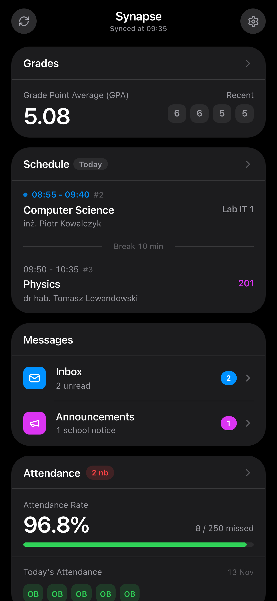
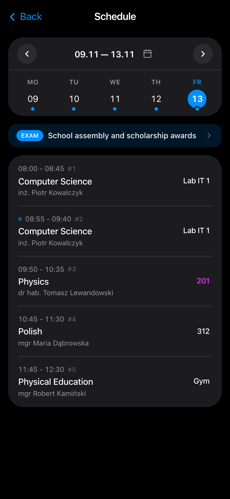
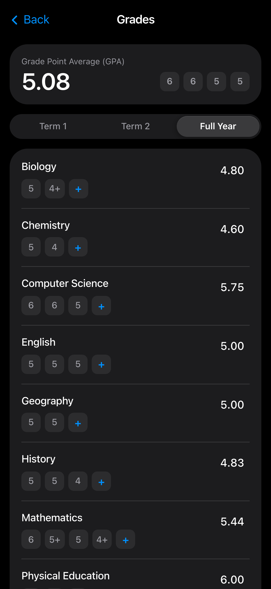
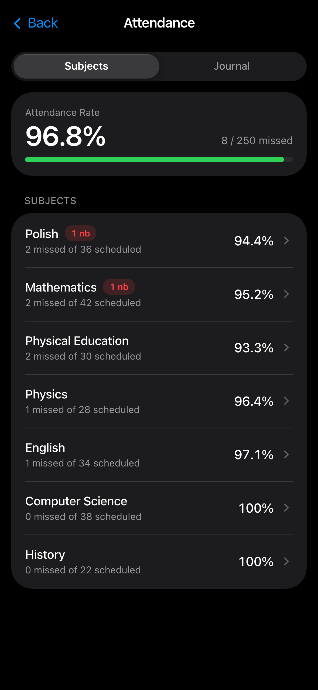
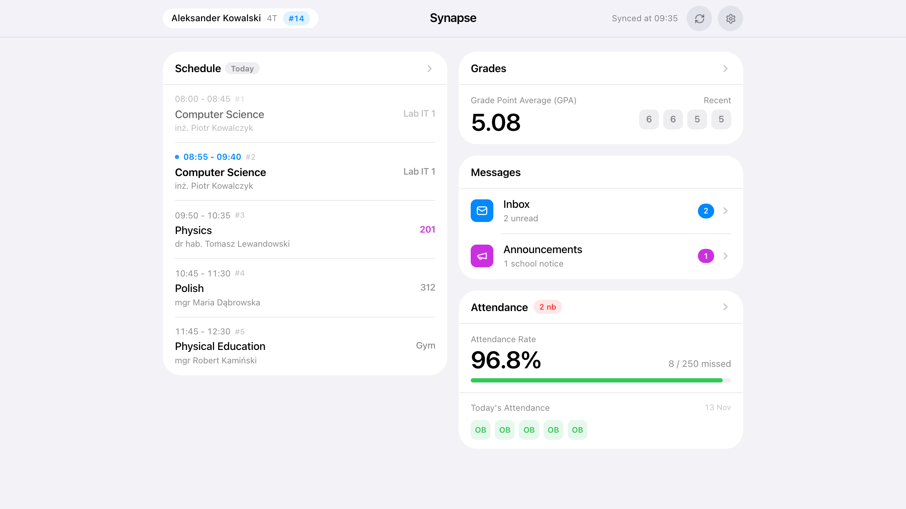

# Synapse

**[🇬🇧 English](README.md)** · **[🇵🇱 Polski](README.pl.md)**

**A fast, private, ad-free client for Poland's Librus Synergia school portal** — built to replace cluttered web portals and paywalled mobile apps with a focused daily dashboard across phones and desktops.

[](https://vercel.com/new/clone?repository-url=https%3A%2F%2Fgithub.com%2Fcra1zer2%2FSynapse)

> Subtly inspired by clean modern mobile design principles, Synapse works as an adaptive web and PWA hybrid: fluid touch cards on smartphones and an expanded multi-column workspace on desktop monitors — with zero ads, zero tracking, and no central servers.

---

## Visual Overview

<p align="center">
  <a href="docs/screenshots/en/dashboard-dark.png" title="Daily Overview (Mobile Dark Mode)">
    
  </a>
  <a href="docs/screenshots/en/schedule-dark.png" title="Smart Timetable (Mobile Dark Mode)">
    
  </a>
  <a href="docs/screenshots/en/grades-dark.png" title="Grades and GPA Calculator (Mobile Dark Mode)">
    
  </a>
  <a href="docs/screenshots/en/attendance-dark.png" title="Attendance Breakdown (Mobile Dark Mode)">
    
  </a>
  <br /><sub><b>Mobile (Dark):</b> Daily Overview · Smart Timetable · Grades &amp; GPA · Attendance</sub>
</p>

<p align="center">
  <a href="docs/screenshots/en/desktop-light.png" title="Adaptive Desktop Layout (Light Mode)">
    
  </a>
  <br /><sub><b>Responsive Desktop Workspace (Light Mode)</b> — automatically adapts to wide screens with the full-day timetable side-by-side with metrics</sub>
</p>

---

## Why Synapse

After the shutdown of popular open-source Android gradebook clients, thousands of Polish students and parents were forced back onto official portals packed with ads, slow multi-step navigation, and paywalls around core features like push views and convenient summaries.

**Synapse** solves that everyday pain cleanly:
- **Actually fast in daily use** — opens straight into cached local data and silently syncs updates in the background instead of reloading heavy multi-page web tables.
- **Privately self-hosted for free** — no shared third-party backend ever holds your school credentials. You deploy your own private copy on Vercel in a minute (or run it locally) and add it straight to your phone's home screen.
- **Built for both students and parents** — switch effortlessly between student and parent accounts, inspect subject deviations, or send e-excuses in seconds.

---

## Key Capabilities

- **Today at a Glance**: Live lesson status, break timer, room changes, recent grades, and unread messages on one customizable home view.
- **Timetable, Exams & Calendar Export**: Automatic merging of double periods, highlighted substitutions/cancellations, upcoming exams/homework timeline, and one-tap `.ics` export to external calendars.
- **Calm Grades & GPA What-If Simulator**: Weighted semester and full-year GPA calculation, configurable `+`/`-` modifier rules, restrained typography that only flags alert marks (`nb`, `0`, `1`) in red, and an inline target-grade planner.
- **Attendance & Parent e-Excuses**: Daily presence indicators separated from the deviation journal (`nb`, `usp`, `sp`, `sL`, `zw`), threshold alerts (`50%` / `75%`), and direct e-excuse submissions with live approval tracking.
- **Messages & School Notices**: Distraction-free inbox, sent folder, staff directory lookup, attachment downloads, and announcements.
- **Bilingual & Adaptive Themes**: Seamless **English / Polish** (`EN / PL`) switching plus Light, Dark, and System appearance modes.

### Customization & Controls

Tailor the interface and grading rules directly from **Settings**:
- **Home Screen Layout**: Reorder widgets or toggle individual cards (**Grades**, **Lesson Plan**, **Tests & Deadlines**, **Messages**, **Attendance**) on or off.
- **Display Preferences**: Switch between full and shortened subject names, show or hide today's lesson attendance strip on phones, toggle homework items, and enable the lucky number banner.
- **Grade Calculation Rules**: Choose how `+` and `-` modifiers affect GPA (`+0.5/-0.25`, `+0.5/-0.5`, `+0.25/-0.25`, or ignore modifiers) and enable or disable the interactive what-if simulator.
- **Accounts, Permissions & Diagnostics**: Add and switch between multiple Student and Parent accounts, optionally allow absence excuses from student profiles, and inspect per-endpoint **Request Timings**.

---

## Try Demo Mode (No Account Needed)

Test every screen, schedule view, grade simulator, and parent workflow right away using built-in demo accounts:

| Role | Username | Password | What It Demonstrates |
| :--- | :--- | :--- | :--- |
| **Student** | `demo` *(or `demou`)* | `demo` | Active timetable, weighted GPA, attendance tracking (`4T`, `#14`) |
| **Parent** | `demor` *(or `demoparent`)* | `demo` | Parent workspace with e-excuse submission flows |

---

## Private Setup in 60 Seconds

1. **Deploy your personal instance on Vercel**:

   [](https://vercel.com/new/clone?repository-url=https%3A%2F%2Fgithub.com%2Fcra1zer2%2FSynapse)

   Sign in with GitHub and deploy with defaults (no environment variables required) to get your private URL.
2. **Add to Home Screen** (optional full-screen mode):
   - **Safari (iOS)**: **Share** → **Add to Home Screen**
   - **Chrome (Android)**: **⋮** → **Add to Home screen** / **Install app**
3. **Sign in** with your Librus Synergia credentials or explore with `demo` / `demo`.

---

## Architecture & Engineering

Beneath the minimal interface, Synapse acts as a **stateless Backend-for-Frontend (BFF) and protocol adapter** over Librus Synergia's mixed JSON/HTML infrastructure — built specifically to deliver low-latency UX without storing user data on a central server.

### Highlights Under the Hood

- **Stateless Server Actions Proxy (`src/app/actions.ts`)**: All upstream authentication and fetching execute inside Next.js Server Actions on the user's own deployment. `syncAllUserDataAction` dispatches timetable, grade, and attendance pipelines concurrently via `Promise.all` and instruments per-endpoint latency (`serverTimings`) for built-in diagnostics.
- **Custom Cookie-Jar & Auth Lifecycle (`src/services/session.service.ts`)**: Implements `NativeCookieJar` and `NativeLibrusSession` to manage Synergia's multi-hop redirects and session cookies deterministically without relying on headless browsers.
- **Hybrid Gateway + HTML Scraper Aggregation (`src/services/`)**: Combines Synergia Gateway v2 JSON endpoints (`gateway.service.ts`, `justification.service.ts`) with targeted HTML parsing for endpoints without clean JSON APIs (e.g., rich message bodies via `message-parser.service.ts`, weekly timetable metadata, live justification statuses), with transparent `401` / expired-session recovery and retry.
- **Request Coalescing & Scoped Catalog Cache (`src/services/gateway.service.ts`)**: Deduplicates concurrent identical calls via an `inFlightRequests` map and caches relatively static school catalogs (`Schools`, `Classes`, `Subjects`, `Lessons`, `Attendances/Types`, `Grades/Categories`, `Grades/Comments`, `Me`, `Realizations`) in memory with per-resource TTLs to cut redundant upstream load.
- **Local-First Client Hydration (`src/hooks/`)**: Persists normalized user state and multi-account profiles strictly in browser `localStorage`, delivering instant perceived boot while background sync reconciles fresh upstream state.

### Tech Stack & Layout

Built with **Next.js 15** (App Router & Server Actions), **React 19**, **TypeScript 5**, **Tailwind CSS 4**, **Lucide Icons**, and **Node.js `>= 20.9.0`**.

```text
src/
├── app/            # Next.js entrypoints & stateless Server Actions (actions.ts)
├── components/     # Modular UI features (dashboard, schedule, grades, attendance, messages, settings)
├── config/         # Bilingual dictionaries (PL / EN)
├── hooks/          # Local-first sync, account management, settings & scroll physics
├── models/         # Typed domain models for timetable, grades, attendance & messages
├── services/       # Custom session/cookie jar, Gateway client, parsers, translation & demo generator
└── utils/          # Weighted GPA math, time/break helpers, .ics calendar export & formatting
```

### Local Development

```bash
npm install
npm run dev       # http://localhost:3000
```

Production verification:

```bash
npx tsc --noEmit
npm run build
npm run start
```

---

## Disclaimer & Privacy Notice

- **Independent Open-Source Project**: Synapse is not affiliated with, authorized, or endorsed by **Librus sp. z o.o.** (*Librus* and *Librus Synergia* are trademarks of their respective owners). Intended strictly for personal and educational use.
- **Zero Telemetry, Zero Central Storage**: The repository author does **not** operate any central server or database and never sees your credentials, grades, attendance, or messages. Data resides solely on your device (`localStorage`) and transits directly through your personal Next.js instance.
- **As-Is Software**: Provided without warranties of any kind; use at your own discretion.
