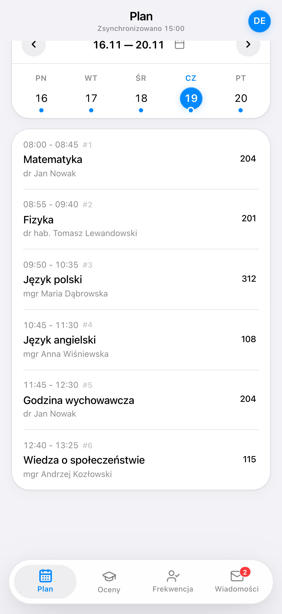
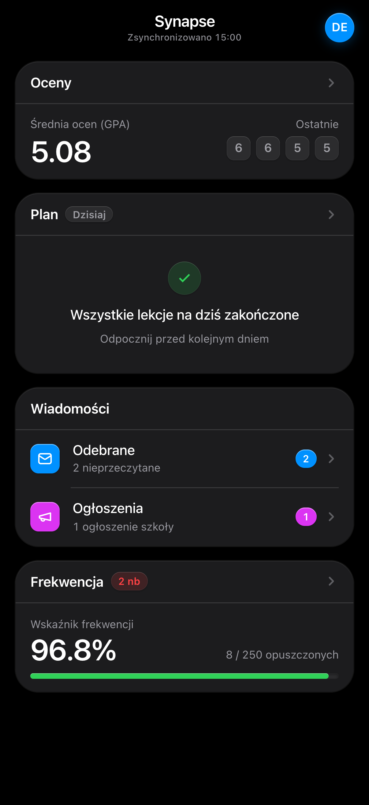
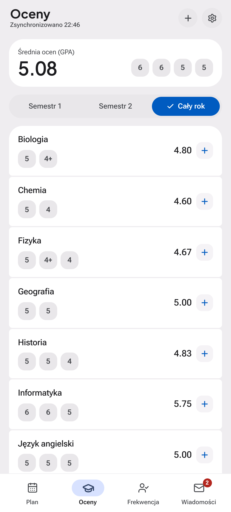
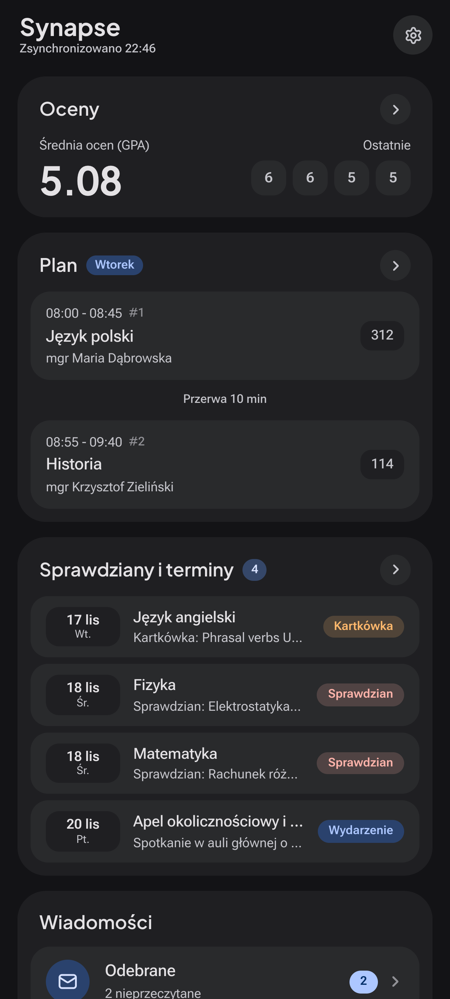
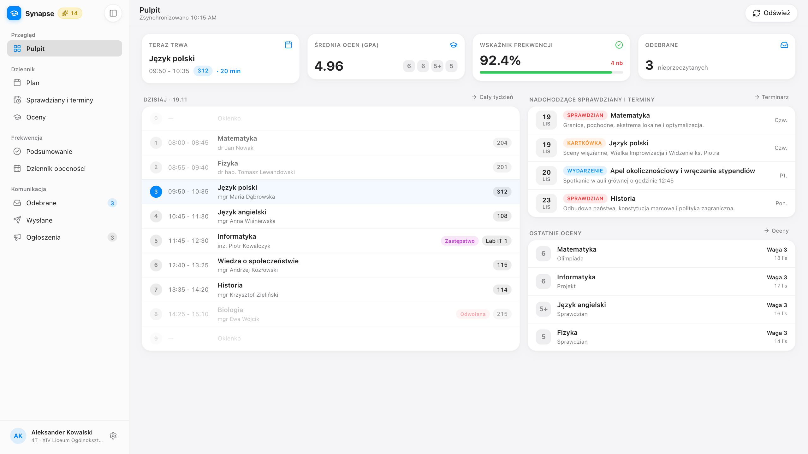

# Synapse — "E-Dziennik" `[WIP · Alpha]`

**[🇬🇧 English](README.md)** · **[🇵🇱 Polski](README.pl.md)**

**Szybki, prywatny i pozbawiony reklam "E-Dziennik" (klient Librus Synergia)** — stworzony, by zastąpić przeładowany portal webowy oraz płatne aplikacje mobilne lekkim, czytelnym widokiem na telefon i komputer.

[](https://vercel.com/new/clone?repository-url=https%3A%2F%2Fgithub.com%2Fcra1zer2%2FSynapse)

> **🚀 Podgląd na żywo i szybkie Demo:** Otwórz **[synapse-ten-smoky.vercel.app](https://synapse-ten-smoky.vercel.app)** i wpisz **`demo` / `demo`** (uczeń) lub **`demor` / `demo`** (rodzic), aby od razu przetestować aplikację na żywo bez własnego konta Librus.
>
> **⚠️ Status WIP / Alpha:** Projekt znajduje się obecnie w fazie **Alpha**. **Układ komputerowy (PC layout)** oraz wariant z **dolnym paskiem nawigacji (Bottom Nav Bar)** są jeszcze w trakcie przebudowy (`WIP`), dlatego **na ten moment zaleca się otwieranie aplikacji z telefonu (w domyślnym widoku widżetów)**.

> Subtelnie inspirowany nowoczesnym wzornictwem mobilnym, Synapse działa jako responsywna hybryda aplikacji webowej i PWA: wygodne karty dotykowe na smartfonie oraz dwukolumnowy układ na szerokim ekranie — bez reklam, śledzenia i zewnętrznych serwerów.

---

## Podgląd interfejsu

<p align="center">
  <a href="docs/screenshots/pl/iphone-light-tabs.png" title="iPhone Pro · iOS Jasny + Pasek dolny">
    
  </a>
  <a href="docs/screenshots/pl/iphone-dark-widgets.png" title="iPhone Pro · iOS Ciemny + Widżety">
    
  </a>
  <a href="docs/screenshots/pl/pixel-light-tabs.png" title="Pixel XL · Material 3 Expressive Jasny + Pasek dolny">
    
  </a>
  <a href="docs/screenshots/pl/pixel-dark-widgets.png" title="Pixel XL · Material 3 Expressive Ciemny + Widżety">
    
  </a>
  <br /><sub><b>Warianty mobilne:</b> iPhone Pro (iOS Jasny · Pasek) · iPhone Pro (iOS Ciemny · Widżety) · Pixel XL (M3 Jasny · Pasek) · Pixel XL (M3 Ciemny · Widżety)</sub>
</p>

<p align="center">
  <a href="docs/screenshots/pl/desktop-workspace.png" title="Responsywny widok desktopowy">
    
  </a>
  <br /><sub><b>Responsywny widok desktopowy</b> — pełny plan dnia obok podsumowania ocen, terminarza, wiadomości i frekwencji</sub>
</p>

---

## Dlaczego powstał Synapse

Po zakończeniu wsparcia dla popularnych open-source’owych aplikacji mobilnych na Androida, uczniowie i rodzice zostali skazani na oficjalny portal przepełniony reklamami, wielostopniową nawigacją oraz płatnymi dodatkami blokującymi podstawowe udogodnienia.

**Synapse** rozwiązuje ten codzienny problem:
- **Błyskawiczne działanie na co dzień** — otwiera się natychmiast z lokalnej pamięci podręcznej i dyskretnie synchronizuje zmiany w tle zamiast za każdym razem przeładowywać ciężkie tabele HTML.
- **Własna, prywatna instancja za darmo** — żaden wspólny serwer osób trzecich nie przechowuje Twojego hasła. W minutę stawiasz własną kopię na Vercel (albo lokalnie) i dodajesz ją do ekranu głównego telefonu.
- **Dla ucznia i dla rodzica** — szybkie przełączanie między kontami, czytelne odchylenia frekwencji i wygodne wysyłanie e-usprawiedliwień.

---

## Główne możliwości

- **Dzień szkolny w jednym spojrzeniu**: Status trwającej lekcji, odliczanie do końca przerwy, wyróżnione zmiany sal, ostatnie oceny i nieprzeczytane wiadomości na konfigurowalnym pulpicie.
- **Plan lekcji, terminarz i eksport `.ics`**: Automatyczne łączenie lekcji dwugodzinnych, czytelne oznaczenia zastępstw i odwołań, lista sprawdzianów i zadań domowych oraz eksport do kalendarza systemowego.
- **Średnia ważona i interaktywny symulator ocen**: Natychmiastowa średnia za semestr i cały rok (`+0.5 / -0.25`), stonowana kolorystyka wyróżniająca na czerwono wyłącznie oceny alarmowe (`nb`, `0`, `1`) oraz przycisk `+` na górnym pasku przełączający listę przedmiotów w tryb symulacji z przestronnym oknem wyboru oceny i wagi.
- **Frekwencja, dziennik odchyleń i e-Usprawiedliwienia**: Dzisiejsze obecności (`OB`) oddzielone od dziennika odchyleń (`nb`, `usp`, `sp`, `sL`, `zw`), progi ostrzegawcze (`50%` / `75%`) oraz wysyłanie i śledzenie e-usprawiedliwień z konta rodzica.
- **Wiadomości i Ogłoszenia**: Czysta skrzynka odbiorcza i wysłane, wygodne wyszukiwanie nauczycieli, pobieranie załączników oraz ogłoszenia szkolne.
- **Rozszerzalne tłumaczenia i języki (`LANGUAGE_REGISTRY`)**: Błyskawiczne przełączanie interfejsu (`PL / EN` z gotową architekturą pod kolejne języki) oraz tłumaczenie w locie przez Google Translate dynamicznych treści z Librusa (przedmioty, tematy lekcji, opisy sprawdzianów i zadań, komentarze ocen, wiadomości i ogłoszenia) bez modyfikowania nazwisk, sal, dat i plików.

### Personalizacja i ustawienia

Dopasuj system projektowy, układ ekranu i funkcje bezpośrednio w **Ustawieniach**:
- **Dwa systemy projektowe (`iOS` i `Material 3 Expressive`)**: Przełączaj na żywo między stylem iOS (szkło i pogrupowane karty) a Material 3 Expressive znanym z Google Pixel (Android 16).
- **Dynamiczne palety Material You**: Wybierz jeden z 8 gotowych motywów kolorystycznych lub wygeneruj pełną paletę tonalną jasną/ciemną z własnego koloru HEX.
- **Tryby nawigacji i ekran główny**: Korzystaj z konfigurowalnych **Widżetów** (zmiana kolejności oraz ukrywanie kart: **Oceny**, **Plan lekcji**, **Sprawdziany i terminy**, **Wiadomości**, **Frekwencja**) albo z natywnego **Dolnego paska nawigacji** (`Plan`, `Oceny`, `Frekwencja`, `Wiadomości`).
- **Motywy, widok i symulator**: Tryb jasny, ciemny lub systemowy, pełne nazwy przedmiotów, pasek dzisiejszej obecności na telefonie, widoczność zadań domowych, powiadomienie o szczęśliwym numerku oraz **Symulator ocen (Co jeśli?)**.
- **Wiele kont i diagnostyka**: Dodawaj i przełączaj konta Ucznia oraz Rodzica, opcjonalnie odblokuj e-usprawiedliwienia dla konta ucznia i sprawdzaj czasy odpowiedzi w podglądzie **Czas zapytań**.

---

## Tryb demonstracyjny (bez własnego konta)

Wszystkie widoki, kalkulator średniej, plan lekcji i obieg e-usprawiedliwień możesz sprawdzić od razu dzięki wbudowanemu trybowi demo:

| Rola | Login | Hasło | Zakres danych |
| :--- | :--- | :--- | :--- |
| **Uczeń** | `demo` *(lub `demou`)* | `demo` | Aktywny plan dnia, oceny ze średnią ważoną, frekwencja (`4T`, `#14`) |
| **Rodzic** | `demor` *(lub `demoparent`)* | `demo` | Widok rodzica z formularzami e-usprawiedliwień |

---

## Prywatne uruchomienie w minutę

1. **Postaw własną kopię na Vercel**:

   [](https://vercel.com/new/clone?repository-url=https%3A%2F%2Fgithub.com%2Fcra1zer2%2FSynapse)

   Zaloguj się kontem GitHub i kliknij **Deploy** (bez konfiguracji zmiennych środowiskowych), aby otrzymać swój prywatny adres URL.
2. **Dodaj do ekranu początkowego** (opcjonalny tryb pełnoekranowy):
   - **Safari (iPhone)**: **Udostępnij** → **Dodaj do ekranu początkowego**
   - **Chrome (Android)**: **⋮** → **Dodaj do ekranu głównego** / **Zainstaluj aplikację**
3. **Zaloguj się** swoimi danymi Librus Synergia lub sprawdź tryb `demo` / `demo`.

---

## Architektura i szczegóły techniczne

Od strony inżynierskiej Synapse pełni rolę **bezstanowego proxy BFF (Backend-for-Frontend) i adaptera protokołu** ponad mieszaną infrastrukturą JSON/HTML systemu Librus Synergia — zaprojektowanego tak, aby zapewnić minimalne opóźnienia przy zachowaniu pełnej prywatności bez centralnej bazy danych.

### Kluczowe elementy rozwiązania

- **Bezstanowy pośrednik Server Actions (`src/app/actions.ts`)**: Cała komunikacja z serwerami szkoły zachodzi wyłącznie w ramach Next.js Server Actions na prywatnej instancji użytkownika. `syncAllUserDataAction` równolegle pobiera plan lekcji, oceny i frekwencję przez `Promise.all` oraz mierzy czasy poszczególnych endpointów (`serverTimings`).
- **Własny silnik sesji i ciasteczek (`src/services/session.service.ts`)**: Klasy `NativeCookieJar` i `NativeLibrusSession` deterministycznie obsługują wieloetapowe przekierowania logowania oraz cykl życia ciasteczek bez narzutu przeglądarek headless.
- **Hybrydowa agregacja API Gateway + HTML (`src/services/`)**: Warstwa serwisów łączy zasoby Gateway API v2 (`gateway.service.ts`, `justification.service.ts`) z precyzyjnym parsowaniem HTML tam, gdzie brakuje kompletnego JSON API (m.in. treści wiadomości w `message-parser.service.ts`, metadane planu lekcji, statusy wniosków e-usprawiedliwień), wraz z automatycznym odzyskiwaniem sesji po wygaśnięciu (`401` / przekierowanie logowania).
- **Grupowanie zapytań i bufor słowników z TTL (`src/services/gateway.service.ts`)**: Mapa `inFlightRequests` deduplikuje równoległe zapytania o ten sam zasób, a `catalogCache` buforuje w pamięci rzadko zmieniające się słowniki (`Schools`, `Classes`, `Subjects`, `Lessons`, `Attendances/Types`, `Grades/Categories`, `Grades/Comments`, `Me`, `Realizations`).
- **Dynamiczny silnik tłumaczeń na angielski (`src/services/translation.service.ts`)**: W trybie angielskim szkolne treści i wieloakapitowe wiadomości są tłumaczone w locie (z ograniczeniem współbieżności, dzieleniem długich treści i buforem w pamięci zamiast statycznego słownika przedmiotów), z pominięciem imion i nazwisk, numerów sal, dat oraz nazw plików.
- **Hydracja Local-First (`src/hooks/`)**: Znormalizowane dane kont i ustawienia interfejsu są utrwalane wyłącznie w `localStorage` przeglądarki, gwarantując natychmiastowy start widoku oraz ciche dociąganie aktualizacji w tle.

### Stos technologiczny i struktura projektu

Zbudowano przy użyciu **Next.js 15** (App Router i Server Actions), **React 19**, **TypeScript 5**, **Tailwind CSS 4**, **Lucide Icons** oraz **Node.js `>= 20.9.0`**.

```text
src/
├── app/            # Punkty wejścia Next.js, powłoka aplikacji i Server Actions (actions.ts)
├── components/ui/  # Bazowe prymitywy interfejsu adaptacyjne dla motywów iOS i Material Design 3
├── config/         # Rozszerzalny rejestr języków i słowniki (LANGUAGE_REGISTRY / PL / EN)
├── features/       # Modułowe sekcje funkcji (auth, dashboard, schedule, grades, attendance, messages, settings)
├── hooks/          # Synchronizacja local-first, obsługa wielu kont, ustawienia i fizyka przewijania
├── models/         # Typowane modele domenowe planu, ocen, frekwencji i wiadomości
├── services/       # Silnik sesji/cookie jar, klient Gateway, parsery, tłumaczenia i generator demo
└── utils/          # Obliczenia średniej ważonej, okna czasowe lekcji, eksport .ics i formatowanie
```

### Uruchomienie lokalne

```bash
npm install
npm run dev       # http://localhost:3000
```

Weryfikacja produkcyjna:

```bash
npx tsc --noEmit
npm run build
npm run start
```

---

## Nota prawna i prywatność

- **Niezależny projekt open-source**: Synapse nie jest powiązany, autoryzowany ani wspierany przez **Librus sp. z o.o.** (*Librus* oraz *Librus Synergia* są znakami towarowymi ich prawnych właścicieli). Projekt przeznaczony jest wyłącznie do użytku osobistego i edukacyjnego.
- **Zero telemetrii i zero centralnego przechowywania danych**: Autor repozytorium **nie utrzymuje** żadnego centralnego serwera ani bazy danych i nie ma dostępu do Twoich poświadczeń, ocen, frekwencji ani wiadomości. Dane pozostają wyłącznie na Twoim urządzeniu (`localStorage`).
- **Brak gwarancji**: Oprogramowanie udostępniane jest w stanie *„takim, jakim jest” (as is)* bez jakichkolwiek gwarancji.
